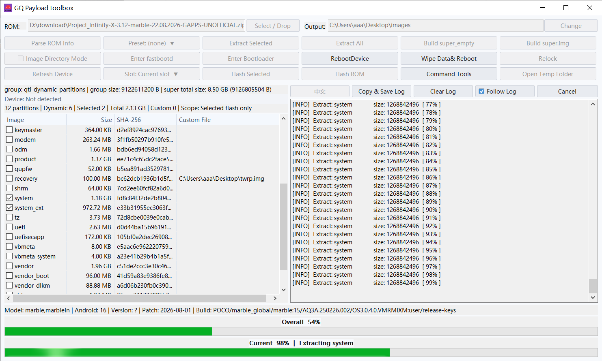
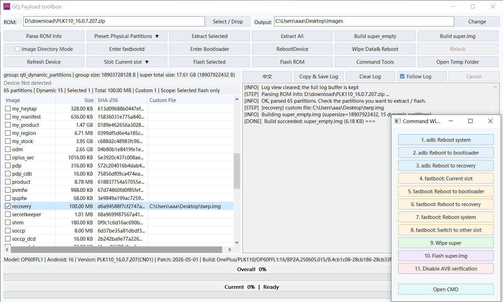
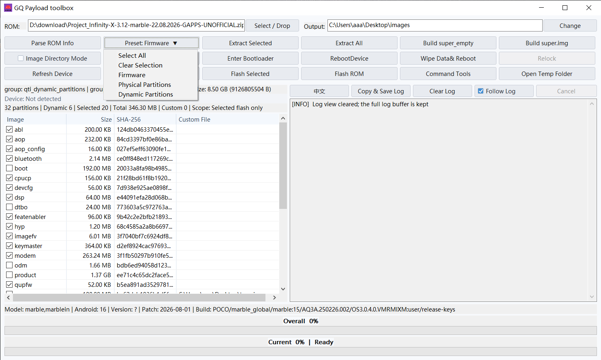
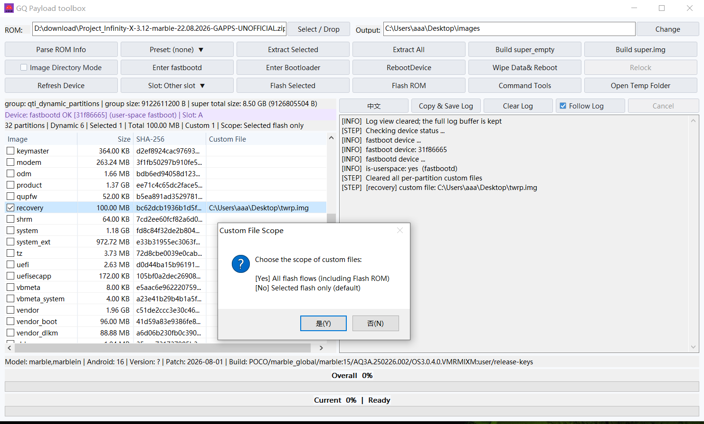
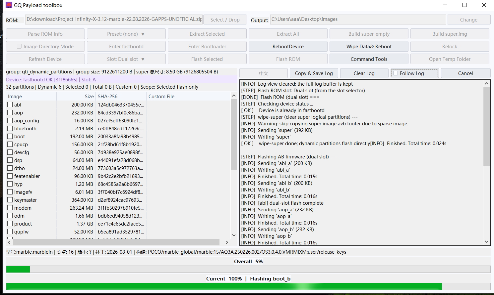
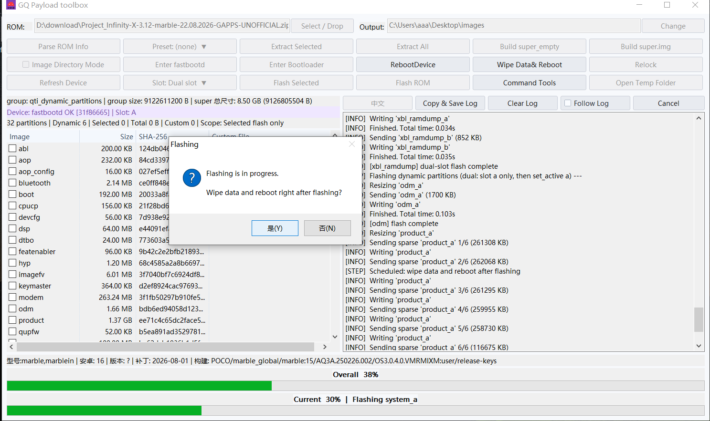

# Fastbootd Payload 刷机工具

[English](#english) | [简体中文](#简体中文)

## English

This is a small Payload flashing tool I made with help from AI. It's mainly for flashing full ROM packages in Payload format from **fastbootd**. Compatible stock/OEM ROMs and AOSP ROMs are supported, as long as the package contains a complete Payload.

### What it can do

- Flash a complete ROM package in Payload format.
- Select image files yourself and flash only the partitions you need.
- Rebuild the dynamic partition layout and generate `super_empty.img` to clear or reset the super metadata.
- Build a complete `super.img`.
- Flash backed-up images, such as `xxx_a.img` and `xxx_b.img`.

### Notes

- Dynamic partition operations are skipped in bootloader Fastboot. Switch to **fastbootd** when working with dynamic partitions.
- Some phones have restrictions in their stock fastbootd. If fastbootd provided by a third-party Recovery works properly on your device, use that where possible.
- For example, some OPlus devices restrict writing the modem partition on the active slot, while some Xiaomi devices restrict flashing dynamic partitions. The exact behavior depends on the device and firmware.
- When using the **Flash ROM** function on OPlus devices, I recommend choosing **Other slot** or **Dual** for the target slot, if available.
- **I strongly recommend against building or flashing a combined `super.img` on OPlus devices from bootloader Fastboot. This may cause a bootloop and prevent the phone from booting.**
- These are issues I've run into; they may not apply to every device.

---

## 简体中文

这是我用ai自己做的一个 Payload 刷机小工具，主要是在 **fastbootd** 里刷完整 OTA 包。兼容的官方 ROM 和 AOSP ROM 都可以，前提是完整的卡刷包( Payload格式)。

### 能做什么

- 刷入完整的 Payload 格式 ROM 包。
- 自己选镜像，也可以只刷需要的分区。
- 重构动态分区布局，并生成 `super_empty.img`，用来清理/重置 super 元数据。
- 可以合成完整的 `super.img`。
- 也能刷备份出来的镜像，比如 `xxx_a.img`、`xxx_b.img`。

### 注意

- Bootloader Fastboot 下会跳过动态分区操作。要操作动态分区，需切换到 **fastbootd**。
- 有些手机的原厂 fastbootd 会有厂商限制。如果第三方 Recovery 自带的 fastbootd 在你的设备上能正常使用，优先选它。
- 比如部分 OPlus 机型不让写当前槽位的 modem 分区，部分 Xiaomi 机型不允许刷入动态分区。具体还是看机型和固件。
- OPlus 设备选择"刷入 ROM"功能 时，建议槽位选 **Other slot** 或 **Dual**，

  非常不建议oplus设备在 Bootloader Fastboot 下合成、刷入 `super.img`，oplus设备可能bootloop无法启动

- 这些只是我遇到过的情况，不是所有机型都一样。

---

## Screenshots / 截图

