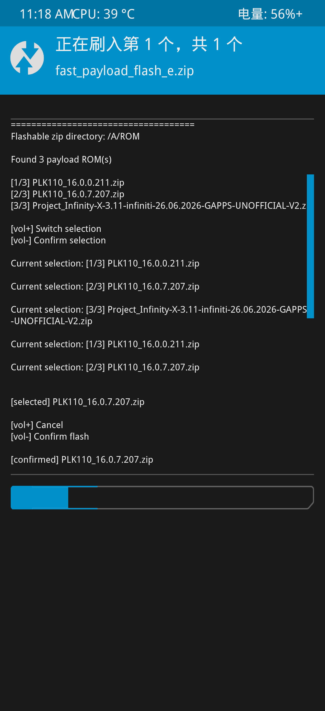
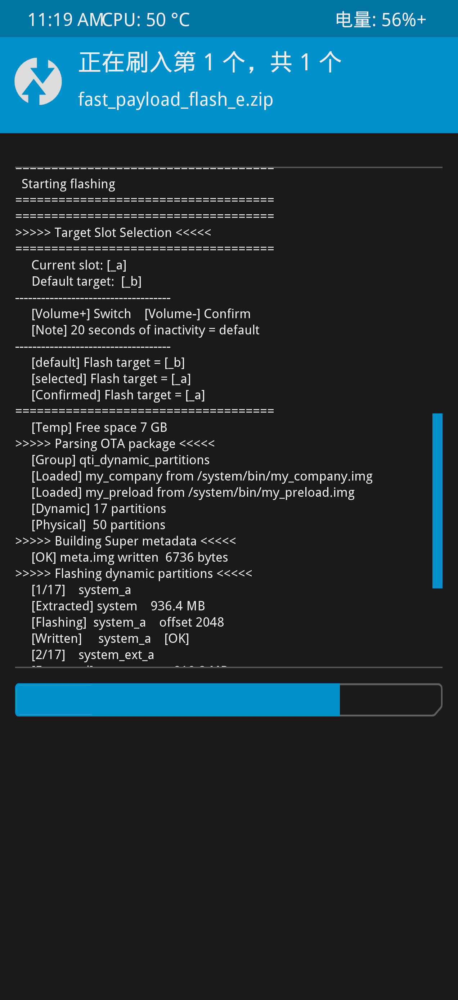
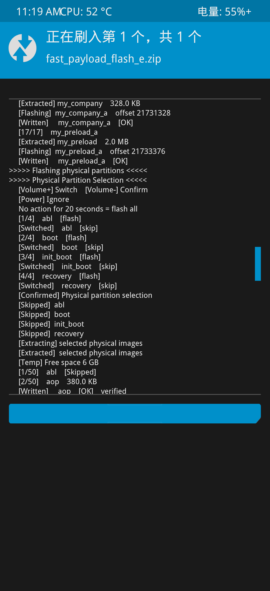
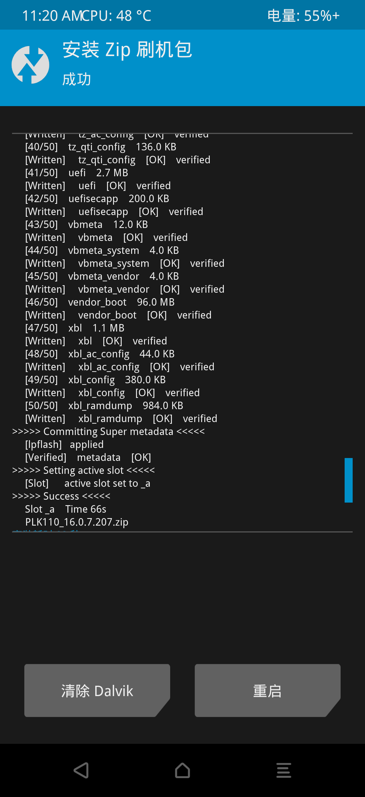

# Recovery Payload 刷机工具

[English](#english) | [简体中文](#简体中文)

## English

This tool runs from a third-party Android Recovery, such as OrangeFox or TWRP. It requires a complete Payload package and supports compatible stock/OEM ROMs and AOSP ROMs.

### What it can do

- Skip partitions you don't want to flash.
- Choose the A/B slot to flash to.
- For dynamic partitions, it creates the super metadata and writes the partition data directly using the mapped offsets. It does not create a combined `super.img`. Once flashing is complete, you can't go back to the previous system using this method.

### Notes

- Put the flashing tool and the ROM ZIP in the same directory.
- In my tests, an AOSP ROM took about **40 seconds**, while an official OPlus ROM took about **70 seconds**. Actual times vary depending on the phone, storage, ROM package, and Recovery.

---

## 简体中文

这个工具是在第三方 Android Recovery 里运行的，比如 OrangeFox、TWRP。刷机包需要是完整的 Payload 包，兼容的官方 ROM 和 AOSP ROM 。

### 简单说下功能

- 可以跳过不想刷的分区。
- 可以自己指定要刷入的 A/B 槽位。
- 动态分区这块是直接生成 super 元数据，再按映射偏移写入数据，不生成`super.img`刷机完成后不能退回上一个系统
- 注意：-刷机工具和 ROM ZIP 放在同一个目录里。
-测试发现，AOSP ROM 大概 **40 秒**，OPlus 官方 ROM 大概 **70 秒**。不同手机、存储速度、ROM 包和 Recovery 都会影响耗时。

---

## Screenshots / 操作截图

